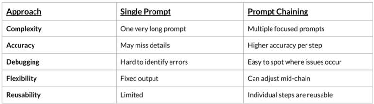

<!-- 
[MD Tips](https://commonmark.org/help/tutorial/) 
<ins>***To be updated***</ins>
-->

# Module 1 – LLM Foundations & Prompt Engineering

## References Module 1.2:
+ [Helicone — LLM API Pricing](https://www.helicone.ai/llm-cost)
+ [Hugging Face — Tokenizers](https://huggingface.co/docs/transformers/tokenizer_summary)
+ [PromptHub — Prompt Engineering](https://www.prompthub.us/blog/the-difference-between-system-messages-and-user-messages-in-prompt-engineering)
+ [Agenta — Manage Context Lengths](https://agenta.ai/blog/top-6-techniques-to-manage-context-length-in-llms)

## Summary Module 1.2:
+ Tokenisation is the process whereby text is broken down into smaller units, with the common approach being Byte Pair Encoding (BPE).
+ When working with LLMs, a few message roles come into play:
    + User – prompts from a human.
    + System – general instructions for the chatbot; shapes its behaviour/style.
    + Assistant – response from the LLM.
+ Context management is key due to the possibility of context being lost; there’s only so much information an LLM can hold (context window). Some of the strategies are:
    + Full History
    + Selective History – a fixed number (n) of texts is stored.
    + Summarisation – a full summary or a summary plus selective history.

## References Module 1.3:
+ [OpenAI — Prompt Engineering](https://help.openai.com/en/articles/6654000-best-practices-for-prompt-engineering-with-the-openai-api)
+ [Humanloop — Structured Outputs](https://humanloop.com/blog/structured-outputs)

## Summary Module 1.3
+ Prompt Engineering:
    + Zero-Shot — basic instructions without examples; “figure it out yourself”.
    + Few-Shot — instructions with examples.
    + Chain-of-Thought (CoT) — thought process output, enabling the user to conduct independent verification.
+ Prompt Chaining — a multi-step interdependent process useful for complex queries.
+ Structured Outputs — JSON is a standard way to store output, ensuring reliability across systems/APIs.
+ JSON Validation:
    + Schema — overall structure, field names, presence of values.
    + Type — string, boolean, number, date string.
    + Value — email format, length of mobile number, positive price.
    + Business Logic — supply > demand, end > start.

<!--  -->

| Approach | Single Prompt | Prompt Chaining |
| :--- | :--- | :--- |
| **Complexity** | One very long prompt | Multiple focused prompts |
| **Accuracy** | May miss details | Higher accuracy per step |
| **Debugging** | Hard to identify errors | Easy to spot where issues occur |
| **Flexibility** | Fixed output | Can adjust mid-chain |
| **Reusability** | Limited | Individual steps are reusable |

<sub>Source: AISG</sub>

## Additional Learnings:
In the non-Math example provided by the course material, a simple few-shot prompt like the one below provided a one-word answer.
````
Classify the sentiment of each review as positive, negative, or neutral:
Review: "This phone is amazing! Best purchase I've made all year."
Sentiment: Positive
Review: "The product broke after two days. Complete waste of money."
Sentiment: Negative
Review: "It's okay, nothing special but does what it's supposed to."
Sentiment: Neutral
````
It appears that Claude is a rather chatty LLM compared to Azure OpenAI and will provide additional justification/reasoning on how it achieved the final outcome. An explicit instruction had to be included to ensure the output matches expectations.
````
Classify the sentiment in {{ question }} as positive, negative, or neutral. Do not include any reasoning, explanation, or extra text.
Review: "This phone is amazing! Best purchase I've made all year."
Sentiment: Positive
Review: "The product broke after two days. Complete waste of money." 
Sentiment: Negative
Review: "It's okay, nothing special but does what it's supposed to." 
Sentiment: Neutral
````

In the Prompt Chaining example, an error was identified with regard to `Failure to Parse`. DeepSeek was utilised to understand the cause and the solution. The main cause of the error was `Streaming`, as quoted from DeepSeek.

> Without Streaming (Batch): The AI generates the entire response in the background. Once it hits the final token, it sends the whole block of text to your app. (This is why older AI tools felt like they were "thinking" for 10 seconds before spitting out a whole paragraph).
> 
> With Streaming: As soon as the AI generates the first token, the server sends it to your app immediately. It keeps a connection open and sends a continuous stream of tiny text chunks.
>     
> You see this every time you use ChatGPT: the text types out letter-by-letter. That is streaming.

In this Flowise/Claude setup, `Streaming` had to be switched off as the initial ping of `""` will be parsed as `Unexpected end of JSON input`.
