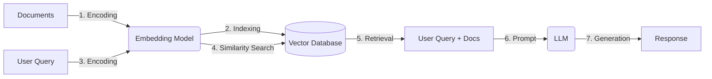

<!-- 
[MD Tips](https://commonmark.org/help/tutorial/) 
<ins>***To be updated***</ins>
-->

# Module 2 – Retrieval Augmented Generation

<ins>***To be updated***</ins>

## References Module 2.1
+ [Xxx — Xxx Xxx](https://www.helicone.ai/llm-cost)

## Summary Module 2.1
+ RAG - utilising LLM engine and supplmenting the knowledge base with proprietary up-to-date information.
+ Architechture - 
+ Document processing
    + Ingestion/Parsing - 
	+ Chunking -
	+ Cleaning/Preprocesing -
	

Source: AISG
[Mermaid — Flowcharts Syntax](https://mermaid.js.org/syntax/flowchart.html)
	
| Strategy | Semantic Coherence | Complexity | Best Use Case |
| :--- | :--- | :--- | :--- |
| Page/Paragraph/Sentence splitting | Variable (High for paragraphs, Low for pages) | Low | Structured documents (legal, medical) |
| Recursive chunking | High (Balances structure & size) | Medium | The Industry Standard for most RAG apps |
| Fixed size + overlap | Low (High risk of cutting ideas) | Low | Generic text, exploratory analysis |
| Semantic chunking | Very High | High | Nuanced, complex narratives |

Source: AISG

## References Module 2.2
+ [Xxx — Xxx Xxx](https://www.helicone.ai/llm-cost)

## Summary Module 2.2
+ xxx
