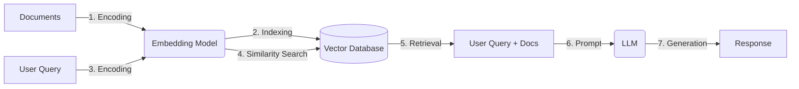

<!-- 
[MD Tips](https://commonmark.org/help/tutorial/) 
<ins>***To be updated***</ins>
-->

# Module 2 – Retrieval Augmented Generation

<ins>***To be updated***</ins>

## References Module 2.1
+ [Helicone — LLM API Pricing](https://www.helicone.ai/llm-cost)

## Summary Module 2.1
+ When working with LLMs, a few message roles come into play:
    + User – prompts from a human.

