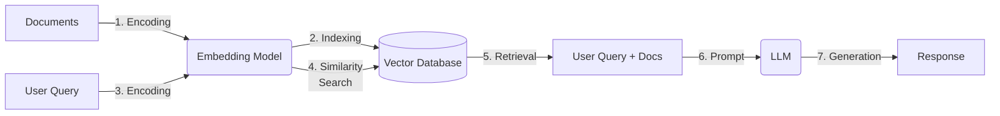

<!--
<ins>***To be updated***</ins>
-->

# Module 2 – Retrieval Augmented Generation

## References Module 2.1
<!--
+ [GitHub Docs — Diagrams](https://docs.github.com/en/get-started/writing-on-github/working-with-advanced-formatting/creating-diagrams)
+ [Mermaid — Flowcharts Syntax](https://mermaid.js.org/syntax/flowchart.html)
-->

## Summary Module 2.1
+ RAG — using a LLM engine and supplementing the knowledge base with proprietary, up-to-date information, thereby reducing hallucinations.
+ Architecture —
+ Document processing
    + Ingestion/Parsing —
    + Chunking —
    + Cleaning/Preprocessing —



<sub>Source: AISG</sub>

| Strategy | Semantic Coherence | Complexity | Best Use Case |
| :--- | :--- | :--- | :--- |
| Page/Paragraph/Sentence splitting | Variable (High for paragraphs, Low for pages) | Low | Structured documents (legal, medical) |
| Recursive chunking | High (Balances structure & size) | Medium | The industry standard for most RAG apps |
| Fixed size + overlap | Low (High risk of cutting ideas) | Low | Generic text, exploratory analysis |
| Semantic chunking | Very High | High | Nuanced, complex narratives |

<sub>Source: AISG</sub>

## References Module 2.2
+ [xxx — xxx](https://www.helicone.ai/llm-cost)

## Summary Module 2.2
+ Embeddings — xxx
+ Similarity Metrics — xxx
+ xxx
+ xxx

## References Module 2.3
+ [xxx — xxx](https://www.helicone.ai/llm-cost)

## Summary Module 2.3
+ Vector Store vs. Vector Index — xxx
+ Flat (Brute Force) Index — xxx
+ Approximate Nearest Neighbours (ANN) — xxx
    + LSH (Locality Sensitive Hashing) — xxx
    + HNSW (Hierarchical Navigable Small World) — xxx
    + Other — xxx
+ Metadata Filtering — xxx
+ Hybrid Search — xxx

## Issues
In the Flowise x Pinecone example, with the architecture setup below:

+ Embedding — OpenAI
+ Vector Store — Pinecone
+ Record Manager — SQLite

It results in an error related to the SQLite path.

> Status: 500
>
> Invalid SQLite path: Windows absolute paths are not allowed

Even when trying an alternative solution found online — using a relative path directory — it still leads to an error.

````npx flowise start --DATABASE_PATH="./.flowise"````

> Status: 500
>
> PineconeBadRequestError: This index has a document schema, so writes must go through the documents API. Use POST /namespaces/{namespace}/documents/upsert, /update or /delete with the X-Pinecone-API-Version header set to 2026-07 or later. The vectors and records write endpoints do not support document schemas. If you are using a client library or integration that only supports the vectors API, upgrade it to a version that supports the documents API.

According to the AISG README, this is a result of the recent Pinecone update; details are below. Even trying to replicate the workflow within Flowise to set up the index via HTTP resulted in a failure. Due to this, will be using n8n to work on the remaining demos.

> after Pinecone's update to integrated embedding models, new indexes created in the Pinecone console may not work with the n8n Pinecone node. This follow-up creates a classic dense-vector index (3072 dimensions, cosine, matching OpenAI text-embedding-3-large) with an HTTP request, so you can finish the Pinecone demo above.
