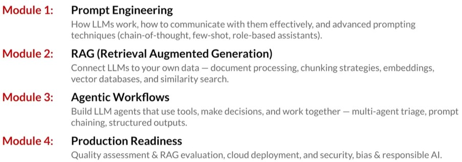
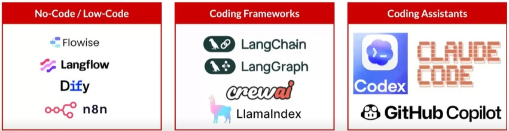

# Module 0 – Course Overview
This is my personal documentation of AI Singapore’s LLM Application Developer Programme (LADP) Essentials. The summary within this document is all self-written unless otherwise stated and has undergone review by DeepSeek only to ensure factual correctness and to proofread where applicable.

The programme revolves around the low-code/no-code platform Flowise, with Claude being the main LLM engine. An overview of the programme, taken directly from AISG-AIAP/LADP-Essentials, can be found below:

<!--  -->

| Module | Description |
| :--- | :--- |
| **M1 Prompt Engineering** | How LLMs work, how to communicate with them effectively, and advanced prompting techniques (chain-of-thought, few-shot, role-based assistants). |
| **M2 RAG (Retrieval Augmented Generation)** | Connect LLMs to your own data — document processing, chunking strategies, embeddings, vector databases, and similarity search. |
| **M3 Agentic Workflows** | Build LLM agents that use tools, make decisions, and work together — multi-agent triage, prompt chaining, structured outputs. |
| **M4 Production Readiness** | Quality assessment & RAG evaluation, cloud deployment, and security, bias & responsible AI. |

Source: AISG

## Repository Structure
Each module folder contains its own README.md, which details the summary of the module along with relevant materials.

***To be updated***

+	`Module_1/` — Intro workflows (first chatbot and first agent) and prompt engineering demos (zero-shot, few-shot, chain-of-thought, prompt chaining)
+	`Module_2/` — RAG workflow demo; documents_for_rag/ contains sample source docs for ingestion
+	`Module_3/` — Agent workflows: triaging agent and report writing agent
+	`Module_4/`
    +	Evaluations/ — notebook, CSV inputs, and .env.example
    +	Deployment/ — Streamlit app, static HTML embed, Docker files, Kubernetes configs, and a Cloud Run deployment guide
+	`Project/` — Phase 2 capstone project: scenario briefs, submission instructions, and a `contributions_from_learners/` folder for learner submissions via Pull Request
+	`Images/` — Images used within this Repo

## Course setup 
+	Install [Node.js](https://nodejs.org/en/download) v22.23.4
    + `(Get-CimInstance Win32_ComputerSystem).SystemType` # To identify your windows architecture.
    + `node -v` # Should print "v22.23.4". 
    + `npm -v` # Should print "10.9.9".
+ Install [Flowise](https://github.com/FlowiseAI/Flowise)
    + `npm install -g flowise@3.1.0`
    + `npx flowise start` # For BAU launch, port 3000 will be used by default
    + `PORT=3001 npx flowise start` # Alternative when port 3000 is not available
+	Launch & End
    + [http://localhost:3000](http://localhost:3000)
    + `Ctrl + C` # To disconnect
    + `Clear`
+	[LLM API](https://console.anthropic.com/])

## Other Tools
<!--  -->

| No-Code / Low-Code | Coding Frameworks | Coding Assistants |
| :---: | :---: | :---: |
| [Flowise](https://flowiseai.com/) | [LangChain](https://www.langchain.com/) | [Codex](https://openai.com/research/codex) |
| [Langflow](https://www.langflow.org/) | [LangGraph](https://www.langchain.com/langgraph) | [Claude Code](https://docs.anthropic.com/en/docs/claude-code/overview) |
| [Dify](https://dify.ai/) | [crewAI](https://www.crewai.com/) | [GitHub Copilot](https://github.com/features/copilot) |
| [n8n](https://n8n.io/) | [LlamaIndex](https://www.llamaindex.ai/) | |

Source: AISG
